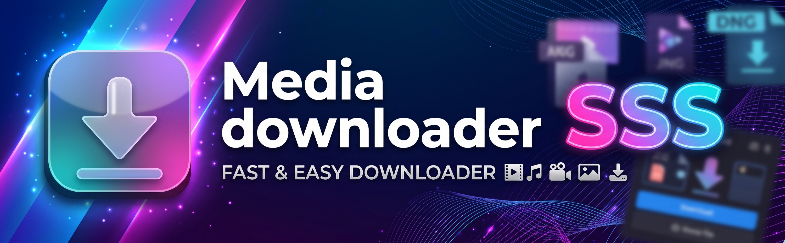
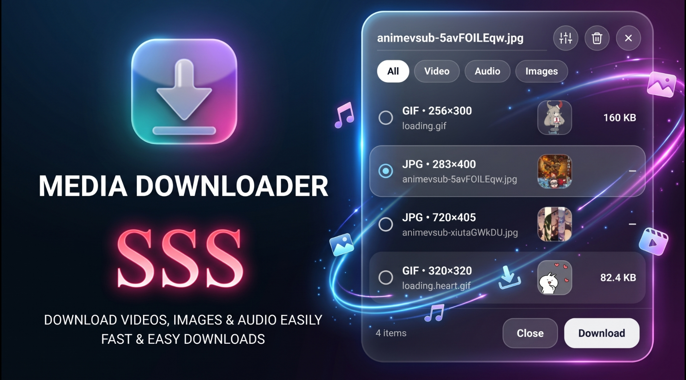
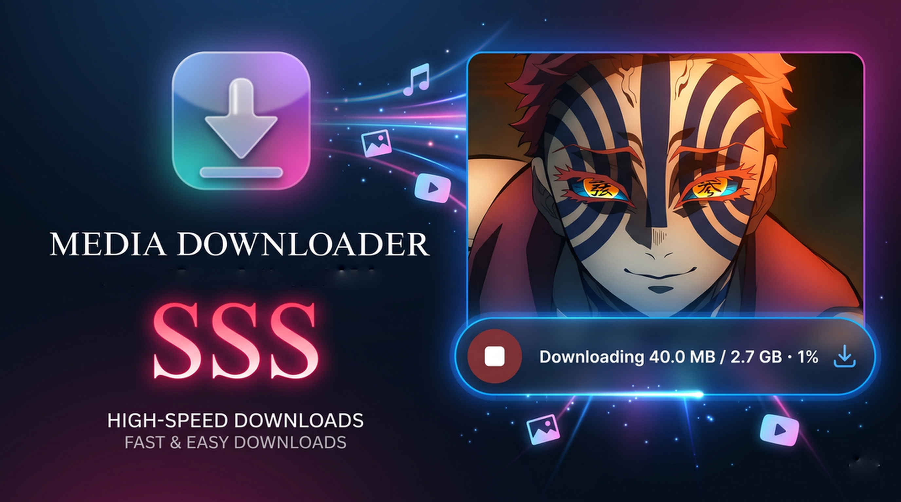
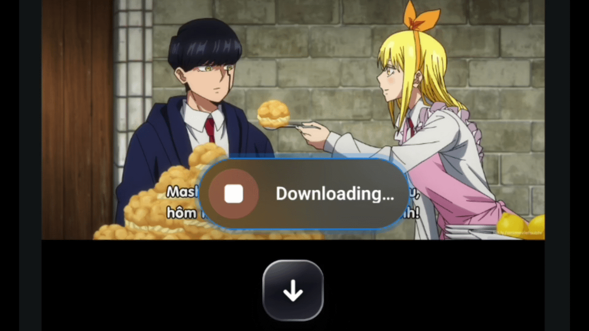
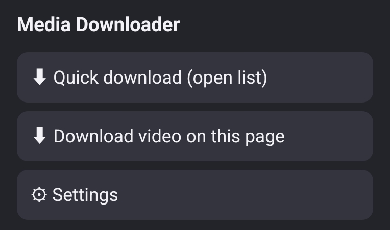
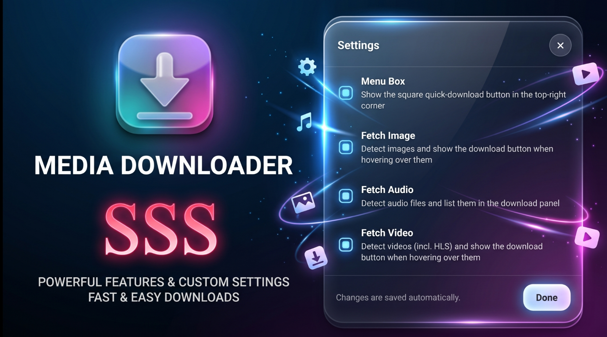

# Media downloader SSS

**Capture and download video, image and audio from almost any web page.**
HLS (.m3u8) streams, YouTube, TikTok and Instagram included. One hover, one click.

---

## ✨ Why Media downloader SSS?

Most downloader add-ons only work on a handful of sites, or bury the download button in menus. **Media downloader SSS** watches what the page actually loads, finds the video, image and audio files, and puts a download button right where you are looking.

- 🖱️ **Hover & click.** Move the mouse over any video, image or audio player and a download button appears.
- ⚡ **Quick download list.** One button shows everything downloadable on the current page.
- 📺 **Streaming support.** Downloads HLS (`.m3u8`) streams, including AES-128 encrypted ones, and joins them into a single file.
- 🎬 **Built-in YouTube, TikTok and Instagram downloaders.**
- 🔒 **Private by design.** No account, no analytics, no tracking, no remote code.

## 📸 Screenshots

## 🚀 Features

| | Feature | Details |
|---|---|---|
| 🖱️ | **Hover button** | A download button appears when you move the mouse over a video, image or audio player. |
| ⚡ | **Quick download** | A single list of every video, image and audio file found on the current page. |
| 🌊 | **HLS (.m3u8) streams** | Downloads all segments, decrypts AES-128 streams and merges everything into one file. |
| ▶️ | **YouTube** | Choose format (**MP4 / WebM / AV1**) and quality, or download **audio only**. Video and audio are joined into one file, no re-encoding. |
| 🎵 | **TikTok** | Downloads the video you are watching, named after its author and ID. |
| 📷 | **Instagram** | Downloads the video of the post, reel or story you are viewing, with sound. |
| 🎚️ | **Multiple qualities** | Pick a resolution or bitrate whenever the site offers more than one. |
| 📏 | **File size preview** | See the size of a file before you download it. |
| ✏️ | **Editable file name** | Rename the file right on the download card. |
| 🎥 | **Grab mode** | A fallback for players that only expose data through MediaSource / blob streams. |
| 🎨 | **Liquid-glass interface** | A clean, modern look that stays out of your way. |
| ⚙️ | **Settings** | Turn video, image, audio and the hover button on or off. |
| 🧰 | **Toolbar shortcuts** | *Quick download*, *Download video on this page*, *Settings*. |
| 📱 | **Firefox for Android** | Works on mobile too (Firefox for Android 142+). |

## 📥 Installation

1. Open the add-on page: **[Media downloader SSS on Firefox Add-ons](https://addons.mozilla.org/vi/firefox/addon/media-downloader-sss/)**
2. Click **Add to Firefox**.
3. Confirm the permission prompt. That's it!

> **Requirements:** Firefox 140 or newer on desktop, Firefox 142 or newer on Android.

## 🕹️ How to use

### Hover button

1. Open a page with a video, image or audio player.
2. Move the mouse over it. The download button appears.
3. Click it, choose a quality if offered, then press **Download**.

### Quick download list

1. Click the **Media downloader SSS** icon in the Firefox toolbar.
2. Choose **Quick download (open list)**.
3. Pick any item from the list and download it.

### YouTube, TikTok and Instagram

Open a video page, hover over the video and click the button. A card appears with a thumbnail, title, format and quality dropdowns, a file name box and a **Download** button. For YouTube, video and audio tracks are merged automatically into a single file.

If a site's layout changes and the direct link can't be found, use the **"Can't download it? Click here"** button at the bottom of the card to record the video through the player instead.

## 🔐 Privacy

Your browsing is your business.

- ❌ No account required
- ❌ No analytics, ads or trackers
- ❌ No data sent to the developer or any third party
- ❌ No remote code loaded or executed
- ✅ Settings are stored locally in your browser
- ✅ Network requests are made only to the media files you choose to download, and to the site you are on (YouTube, TikTok, Instagram) to find the video's own download addresses

The add-on declares **"no data collection"** in its Firefox manifest.

### Why does it need those permissions?

| Permission | Reason |
|---|---|
| Access to all websites | Media can live on any site or CDN, so the add-on has to be able to detect it anywhere. |
| `downloads` | To save the file you chose to your computer. |
| `storage` | To remember your settings. |
| `webRequest` / `webRequestBlocking` | Only to add the `Referer` / `Origin` headers to requests the add-on itself makes for the file you chose. Many CDNs reject media requests without them. Requests made by web pages are never modified. |

## ❓ FAQ

<b>Does it download DRM-protected videos (Netflix, Disney+, etc.)?</b>

No. DRM-protected streams (Widevine, FairPlay, …) are detected but not downloaded, and nothing in the add-on tries to bypass DRM.

<b>Some YouTube videos can't be downloaded. Why?</b>

Streams that require extra protection on YouTube's side (signature ciphers, SABR or PO tokens) are not downloaded. Try another quality or format, or use the **"Click here"** fallback on the card.

<b>The download button doesn't appear on a site.</b>

Reload the page and make sure the hover button is enabled in **Settings**. You can also open the toolbar popup and use **Quick download** to list everything the page has loaded.

<b>Does it work on other browsers?</b>

Media downloader SSS is built for **Firefox** (desktop and Android).

<b>Is it free?</b>

Yes. Install it from the official Firefox Add-ons page.

## ⚖️ Legal notice

Only download content that you own, that is in the public domain, or that you otherwise have the right to save. You are responsible for complying with the terms of service of the websites you visit and with the copyright laws of your country. The author does not endorse the unauthorized download of copyrighted material.

## 🙏 Credits

- Created by **ToanCreator**.
- The video + audio merging component and parts of the YouTube / TikTok / Instagram support are derived from [*Video Downloader Legal*](https://github.com/aspidovss/video-downloader-legal) by **AspidovSS**, used under the MIT License.

## 💬 Feedback & support

Found a bug or have an idea? Leave a review or contact me through the add-on page:
**[addons.mozilla.org/firefox/addon/media-downloader-sss](https://addons.mozilla.org/vi/firefox/addon/media-downloader-sss/)**

---

If you like Media downloader SSS, a ⭐ review on Firefox Add-ons helps a lot.

